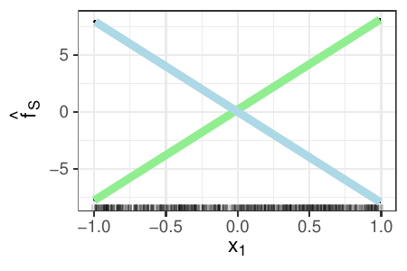
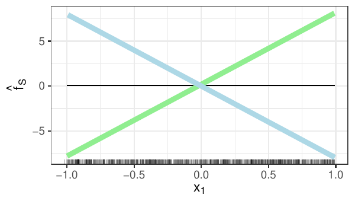
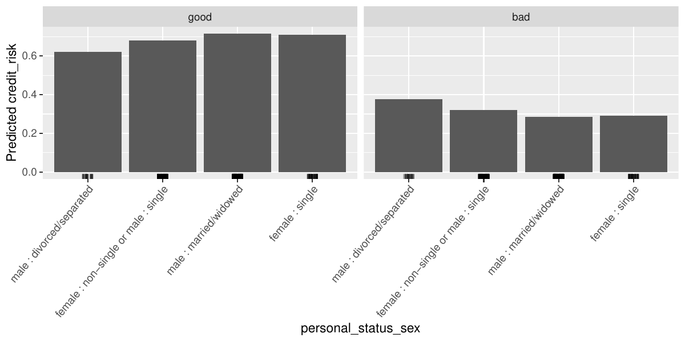



::: {.hint label="Hint: Useful libraries"}
::: {.panel-tabset group="language"}
### R

### Python

:::
:::

## Exercise 1: PDP and ICE in case of interactions

::: {.callout-note title="Learning goals" icon=false}
1. Derive PD and ICE functions analytically for a model with an interaction term.
2. Explain why PDPs can obfuscate heterogeneous effects and why ICE curves should be displayed alongside them.
3. Implement ICE, PDP and their centered variants from scratch.
:::

Let us assume that we fitted the following linear regression model with two features:

$$
\fh(\xv) = \fh(x_1, x_2) = \hat\beta_1 x_1 + \hat\beta_2 x_2 + \hat\beta_3 x_1 x_2 + \hat\beta_0.
$$

a) Analytically derive the PD function of feature $S = \{1\}$ (with $C = \{2\}$).

   ::: {.hint}
   In the lecture slides we derived the PD function for a linear regression model without an interaction term.
   In the end, your solution should include terms like the expected value of $X_2$.
   :::

::: {.sol}
Derivation of the PD function for $S = \{1\}$ (with $C = \{2\}$) given the model above:

$$
\begin{aligned}
f_{1, PD}(x_1) = \E_{x_2} \left( \fh(x_1, x_2) \right) &= \int_{-\infty}^{\infty} \left( \hat\beta_1 x_1 + \hat\beta_2 x_2 + \hat\beta_3 x_1 x_2 + \hat\beta_0 \right) \, d\P(x_2) \\
&= \hat\beta_1 x_1 + \int_{-\infty}^{\infty} \hat\beta_2 x_2 + \hat\beta_3 x_1 x_2 \, d\P(x_2) + \hat\beta_0 \\
&= \hat\beta_1 x_1 + \int_{-\infty}^{\infty} (\hat\beta_2 + \hat\beta_3 x_1) x_2 \, d\P(x_2) + \hat\beta_0 \\
&= \hat\beta_1 x_1 + (\hat\beta_2 + \hat\beta_3 x_1) \cdot \int_{-\infty}^{\infty} x_2 \, d\P(x_2) + \hat\beta_0 \\
&= \hat\beta_1 x_1 + (\hat\beta_2 + \hat\beta_3 x_1) \cdot \E_{x_2} (x_2) + \hat\beta_0
\end{aligned}
$$
:::

b) Let us assume that the estimated coefficients in the model above are $\hat\beta_0 = 0$, $\hat\beta_1 = -8$, $\hat\beta_2 = 0.2$ and $\hat\beta_3 = 16$.
   Furthermore, $X_1 \sim Unif(-1, 1)$ is uniformly distributed between -1 and 1, and $X_2 \sim B(1, 0.5)$ origins from a Bernoulli distribution.
   Compute the exact PD function of feature $X_1$ using your derived function of a).

::: {.sol}
PD function for $\hat\beta_0 = 0$, $\hat\beta_1 = -8$, $\hat\beta_2 = 0.2$, $\hat\beta_3 = 16$, $X_1 \sim Unif(-1, 1)$ and $X_2 \sim B(1, 0.5)$:

$$
\begin{aligned}
f_{1, PD}(x_1) = \hat\beta_1 x_1 + (\hat\beta_2 + 16 x_1) \cdot \E_{x_2} (x_2) + \hat\beta_0
&= -8 x_1 + (0.2 + 16 x_1) \cdot \E_{x_2} (x_2) + 0 \\
&= -8 x_1 + (0.2 + 16 x_1) \cdot 0.5 \\
&= -8 x_1 + 0.1 + 8 x_1 \\
&= 0.1
\end{aligned}
$$
:::

c) The following plot displays the ICE curves of $X_1$. The rugs show the marginal distribution of $X_1$.
   Please note that since $X_2$ is binary, we do not receive $n$ individual ICE curves, but indeed only two unique ones.
   Derive the conditional expectation functions $\fh_1^{(i)}(x_1)$ of $X_1$ for group $X_2 = 1$ and for group $X_2 = 0$ using the model above given the estimated coefficients of b).
   Which color coding (light green or light blue) reflects the group $X_2 = 1$, which one group $X_2 = 0$?

::: {.indent}
{width=70% fig-align="center"}
:::

::: {.sol}
ICE functions for group $X_2 = 1$ and for group $X_2 = 0$:

$$
f_1(x_1) = \begin{cases}
- 8 x_1 + (0.2 + 16 x_1) \cdot 1 = 8 x_1 + 0.2 & x_2 = 1 \\
- 8 x_1 + (0.2 + 16 x_1) \cdot 0 = - 8 x_1 & x_2 = 0
\end{cases}
$$

The light green dots correspond to group $X_2 = 1$, the light blue dots to group $X_2 = 0$.
:::

d) Add the PDP you derived in b) to the plot.
   Use this example to explain briefly why it is advisable to display not only the PDP but also the ICE curves, when visualizing the feature effects of a specific model.

::: {.sol}
The example illustrates that by the averaging of ICE curves for a PD plot we might obfuscate heterogeneous effects and interactions.
Although the ICE curves here show a strong effect of $X_1$ on $Y$, the effect is not apparent in the PDP.
Therefore, it is highly recommended to plot PD plots and ICE curves together.

{width=70% fig-align="center"}
:::

e) **Implementation: ICE and PDP.**
   Write functions that, given a fitted model object, a data matrix $\mathbf{X}$, a feature index $j$ and a specified grid of values, do the following:

   (i) `ice(model, X, j, grid)` -- returns an $n \times g$ matrix of ICE predictions (one curve per row, one grid value per column);
   (ii) `pdp(model, X, j, grid)` -- returns the length-$g$ PD vector by averaging the ICE matrix column-wise.

::: {.sol}
We implement both functions and test them on simulated data from b).

::: {.panel-tabset group="language"}
### R
`ice()` repeats every observation once per grid value, sweeps the grid over column $j$ and reshapes the vectorized model call into an $n \times g$ matrix; `pdp()` averages it column-wise.

### Python
`ice()` repeats every observation once per grid value, sweeps the grid over column $j$ and reshapes the vectorized model call into an $n \times g$ matrix; `pdp()` averages it column-wise.

:::

To check the functions, we simulate data according to b) and plot the ICE curves together with the PDP:

::: {.panel-tabset group="language"}
### R

### Python

:::

As derived in b), the PDP is the constant function $0.1$, while the two groups of ICE curves have slopes $8$ and $-8$.
:::

f) **Implementation: centered variants.**
   Extend the code with

   (i) `c_ice(model, X, j, grid, ref = 1)` -- centers every ICE curve by subtracting its value at the reference grid index `ref` (the "vertical shift" in the slides which is often set to the minimum value);
   (ii) `c_pdp(model, X, j, grid, ref = 1)` -- averages the centered ICE curves to obtain a centered PDP which is zero at the reference point.

   Use the definitions of c-ICE and c-PDP from the lecture slides to guide your implementation.

::: {.sol}
Centering subtracts from each ICE curve its own prediction at the reference grid point; the centered PDP is the column mean of the centered ICE matrix and is zero at the reference point.

::: {.panel-tabset group="language"}
### R

### Python

:::

Plotting the centered curves makes the two interaction groups directly comparable at the reference point:

::: {.panel-tabset group="language"}
### R

### Python

:::
:::

## Exercise 2: Derivative, Forward, and Non-Linearity Effects

::: {.callout-note title="Learning goals" icon=false}
1. Derive derivative and forward marginal effects analytically.
2. Explain how curvature makes dME and fME differ for finite step sizes.
3. Compute and interpret the Non-Linearity Measure (NLM) as an $R^2$ of the local secant.
:::

Let us consider the following non-linear regression model:

$$
\hat{f}(x_1, x_2) = \theta_0 + \theta_1 x_1^2 + \theta_2 x_2^2 + \theta_{1,2} x_1 x_2
$$

with parameters $\theta_0 = 0$, $\theta_1 = 1$, $\theta_2 = 0.5$, and $\theta_{1,2} = 2$.

a) Derive the analytic expression for the *derivative marginal effect* (dME) of feature $x_1$.

::: {.sol}
$$
\text{dME}_1(x_1,x_2) = \frac{\partial\hat f}{\partial x_1} = 2\theta_1 x_1 + \theta_{1,2} x_2 = 2 x_1 + 2 x_2.
$$

*Discussion.* Because the model is quadratic in $x_1$, the derivative is a *linear* function of both $x_1$ and $x_2$.
If the surface were exactly linear, this rate would coincide with any finite difference.
:::

b) Derive the expression for the *forward marginal effect* (fME) of $x_1$ with step size $h_1 > 0$.

::: {.sol}
$$
\text{fME}_1(x_1,x_2;h_1) = \hat f(x_1+h_1,x_2) - \hat f(x_1,x_2).
$$

Expand $\hat f(x_1+h_1,x_2)$:

$$
\begin{aligned}
\hat f(x_1+h_1,x_2)
&= \theta_1(x_1+h_1)^2 + \theta_2 x_2^2 + \theta_{1,2}(x_1+h_1) x_2 \\
&= \theta_1\bigl[x_1^2 + 2 x_1 h_1 + h_1^2\bigr] + \theta_2 x_2^2 + \theta_{1,2} x_1 x_2 + \theta_{1,2} h_1 x_2.
\end{aligned}
$$

Subtracting $\hat f(x_1,x_2)$ gives

$$
\boxed{\;\text{fME}_1(x_1,x_2;h_1) = 2\theta_1 x_1 h_1 + \theta_1 h_1^{2} + \theta_{1,2} x_2 h_1\;} = 2 x_1 h_1 + h_1^{2} + 2 x_2 h_1.
$$

*Discussion.* The extra term $\theta_1 h_1^{2}$ captures curvature; it vanishes faster than linearly when $h_1 \to 0$, at which point fME converges to dME.
:::

c) Let $x_1 = 1$, $x_2 = 2$, and $h_1 = 1$. Compute $\text{dME}_1(1, 2)$ and $\text{fME}_1(1, 2; h_1 = 1)$ and explain why these two results differ and interpret the additional terms appearing in the fME.

::: {.sol}
Numerical evaluation at $(x_1, x_2, h_1) = (1, 2, 1)$:

$$
\begin{aligned}
\text{dME}_1(1,2) &= 2(1)+2(2) = 6, \\
\text{fME}_1(1,2;1) &= 2 \cdot 1 \cdot 1 + 1^2 + 2 \cdot 2 \cdot 1 = 2+1+4 = 7.
\end{aligned}
$$

*Why different?* The derivative $6$ is the *instantaneous* slope.
The finite step of $1$ exposes curvature; the quadratic term makes the actual change go up to $7$.
Hence, using dME for a sizeable perturbation would misestimate (over- or under-predict) the effect.
:::

d) **Non-Linearity Measure (NLM):** We want to test how well the secant (local linear approximation) fits the model output along the direction of $x_1$.
   The NLM defined below quantifies how well the local linear approximation (secant) explains the variation in the model output along the direction of $h_1$.
   For $T$ grid points $(\mathbf{x}^{(i)})_{i=1}^{T}$, it is defined as:

   $$
   \mathrm{NLM} = 1 -
   \frac{\displaystyle \overbrace{\sum_{i=1}^{T} \bigl[\hat f(\mathbf{x}^{(i)})-g(t_i)\bigr]^2}^{\text{SSR: error of secant}}}
        {\displaystyle \underbrace{\sum_{i=1}^{T} \bigl[\hat f(\mathbf{x}^{(i)})-\bar f\bigr]^2}_{\text{SST: total variance}}}.
   $$

   - $t_i \in (0,1)$ parametrises the path (here only in $x_1$ direction): $\mathbf{x}^{(i)} = (x_1 + t_i h_1, x_2)$.
   - $g(t_i) = \hat f(x_1,x_2) + t_i \cdot \text{fME}_1(x_1,x_2;h_1)$ is the secant (straight line) through the two end-points.
   - $\bar f = \frac{1}{T} \sum_{i=1}^{T} \hat f(\mathbf{x}^{(i)})$ is the mean prediction on the path.
   - Hence NLM is an $R^{2}$: $1$ means perfect linear fit, values $\ll 1$ reveal curvature.

   Compute the NLM for $x_1 = 1$, $x_2 = 2$, and stepsize $h_1 = 0.5$.
   Interpret your result in relation to the fit of a local linear approximation using the $T = 9$ equidistant points $t_i = 0.1, 0.2, \dots, 0.9$ below:

   | $i$ | $t_i$ | $x_1^{(i)}=1+0.5t_i$ | $\hat f(\mathbf{x}^{(i)})$ | $g(t_i)$ |
   |---|---|---|---|---|
   | 1 | 0.1 | 1.05 | 7.3025 | 7.3250 |
   | 2 | 0.2 | 1.10 | 7.6100 | 7.6500 |
   | 3 | 0.3 | 1.15 | 7.9225 | 7.9750 |
   | 4 | 0.4 | 1.20 | 8.2400 | 8.3000 |
   | 5 | 0.5 | 1.25 | 8.5625 | 8.6250 |
   | 6 | 0.6 | 1.30 | 8.8900 | 8.9500 |
   | 7 | 0.7 | 1.35 | 9.2225 | 9.2750 |
   | 8 | 0.8 | 1.40 | 9.5600 | 9.6000 |
   | 9 | 0.9 | 1.45 | 9.9025 | 9.9250 |

::: {.sol}
::: {.hint}
- Compute $\text{SSR} = \sum(\hat f - g)^2$ and $\text{SST} = \sum(\hat f - \bar f)^2$ from the table.
- Then evaluate $\mathrm{NLM} = 1 - \mathrm{SSR}/\mathrm{SST}$.
- Comment: Is the resulting NLM close enough to $1$ to accept the secant as a faithful local explanation?
:::

**Step 1: Path points.** For the $T = 9$ equidistant points $t_i = 0.1, \dots, 0.9$:

$$
x_1^{(i)} = 1 + t_i h_1 = 1 + 0.5\, t_i, \qquad x_2^{(i)} = 2.
$$

**Step 2: Model and secant values.**

$$
f_i = \hat f(x_1^{(i)}, 2), \qquad
g_i = \hat f(1,2) + t_i \cdot \text{fME}_1(1,2;0.5), \qquad
\hat f(1,2) = 7, \quad \text{fME} = 3.25,
$$

which are exactly the two last columns of the table.

**Step 3: Compute the $R^2$.**

$$
\text{NLM} = 1 - \frac{\sum_{i=1}^{9}(f_i-g_i)^2}{\sum_{i=1}^{9}(f_i-\bar f)^2}, \qquad \bar f = \frac{1}{9}\sum_{i=1}^9 f_i.
$$

Numerically

$$
\boxed{\text{NLM} \approx 0.9967}.
$$

*Interpretation.* Along the half-unit move in $x_1$, the quadratic surface is *almost* linear (NLM very close to 1).
If we doubled $h_1$, the numerator would grow faster than the denominator, lowering NLM and signaling stronger curvature.
:::

e) **Implementation:** Write three functions:

   - A function `dME(f, x, j)` that computes a central difference approximation of the derivative marginal effect for feature $x_j$ at input $x$.
   - A function `fME(f, x, h)` that computes the forward marginal effect using a vector of stepsizes $h$.
   - A function `NLM(f, x, h, t_vals)` that computes the Non-Linearity Measure as described in d) where `t_vals` are the grid points used to estimate the NLM.

   Use them to confirm the results from sub-tasks c) and d).

::: {.sol}
The three functions follow the definitions directly; `dME()` uses a central difference with a small $h$:

::: {.panel-tabset group="language"}
### R

### Python

:::

Evaluating them for the model of this exercise confirms c) and d): $\text{dME}_1(1,2) = 6$, $\text{fME}_1(1,2;1) = 7$ and $\text{NLM} \approx 0.9967$ for $h_1 = 0.5$.

::: {.panel-tabset group="language"}
### R

### Python

:::

Visually, the tangent (slope dME) and the secant (slope fME$/h_1$) almost coincide with the prediction curve on this path, matching the NLM close to 1:

::: {.panel-tabset group="language"}
### R

### Python

:::
:::

## Exercise 3: ALE

::: {.callout-note title="Learning goals" icon=false}
1. Explain how ALE uses intervals and local prediction differences to estimate feature effects.
2. Implement the ALE algorithm (interval bounds, accumulation, centering) from scratch.
3. Prepare and visualize ALE curves for a fitted model.
:::

Accumulated local effects describe how features influence the prediction of a machine learning model on average.
The following tasks guide you to implement ALE from scratch and to test your code on the wheat seeds dataset ([data/wheat_seeds.csv](https://github.com/slds-lmu/lecture_iml/blob/master/exercises/data/wheat_seeds.csv)).
We prepare the data and fit a random forest; your functions are then tested on this model:

::: {.indent}
::: {.panel-tabset group="language"}
### R

### Python

:::
:::

a) Since ALE works with bins, we have to select bounds first. Usually the bins are chosen s.t. every bin has roughly the same number of data points. However, to make it more simple, we use the same length for every interval.
   Complete the function `get_bounds()` to select bounds between the minimum and maximum value of a feature by using `n_intervals`.
   Those bounds are used for the calculation of ALE in the next tasks.

::: {.sol}
Pseudocode of `get_bounds()`:

```
Require X: input data
Require s: index of the feature for calculating ALE
Require n_intervals: number of intervals
  x_s     <- s-th column of X
  x_s_min <- min value of x_s
  x_s_max <- max value of x_s
  return equidistant sequence of n_intervals + 1 grid points
         between x_s_min and x_s_max
```

::: {.panel-tabset group="language"}
### R

### Python

:::
:::

b) Implement the ALE algorithm from scratch inside the function `calculate_ale()` using the bounds from the previous task and the help of the lecture material.
   For each interval `k`:

   - Select the observations inside the interval (if zero observations are found then return 0 for this interval). In general $x_s$ can be counted as included if it is bigger than the lower bound and smaller or equal than the upper bound. However, make sure the elements in the first bound are included as well.
   - Intervention: Use the relevant observations to create two new datasets:
     - `X_min`: Values at $s$-th feature position are replaced by the lower interval value $z_{k-1}$.
     - `X_max`: Values at $s$-th feature position are replaced by the higher interval value $z_k$.
   - Prediction: Get the predictions for both `X_min` and `X_max`. Compute the differences in predictions of `X_max` to `X_min` and average them.

   Use `cumsum` in R or `np.cumsum` in Python to perform the aggregation step and therefore to get accumulated values for each interval value.
   Finally, if the `center` parameter is set, center each interval by subtracting the average of all interval values.

   ::: {.hint}
   `mapply` in R or `zip(bounds, bounds[1:])` in Python are nice tricks to iterate over the lower and upper bounds at the same time.
   :::

::: {.sol}
Pseudocode of `calculate_ale()`:

```
Require model: model with a predict method
Require X: input data
Require s: index of the feature for calculating ALE
Require n_intervals: number of intervals
Require centered: whether to return centered or uncentered ALE
  bounds     <- get_bounds(X, s, n_intervals)
  lowerbound <- lower interval bounds
  upperbound <- upper interval bounds
  result     <- {}
  for i1 in lowerbound & i2 in upperbound:
      idx <- ids of datapoints of X in (i1, i2]   # first interval: [i1, i2]
      if idx is empty:
          diff <- 0
      else:
          X_min <- X[idx, ] with feature values of s replaced by i1
          X_max <- X[idx, ] with feature values of s replaced by i2
          y_min <- model predictions of X_min
          y_max <- model predictions of X_max
          diff  <- y_max - y_min
      result <- {result, mean of diff}
  uncentered_ale <- cumulative sum of result
  if centered:
      centered_ale <- uncentered_ale - (mean of uncentered_ale)
  return bounds and either uncentered_ale or centered_ale
```

::: {.panel-tabset group="language"}
### R

### Python

:::
:::

c) The function `calculate_ale()` returns both the used bounds and the ALE data. To use those data with `ggplot2` (R) or `matplotlib` (Python), you have to get the corresponding interval centers.
   Implement the function `prepare_ale()`, which should call `calculate_ale()` first and then compute the averages/centers per interval.
   In the end `prepare_ale()` should return the centers plus the corresponding ALE values -- either as a `data.frame` (R) or two vectors (Python).

::: {.sol}
Pseudocode of `prepare_ale()`:

```
Require model, X, s, n_intervals, centered (as before)
  bounds, y  <- calculate_ale(X, s, n_intervals, centered)
  lowerbound <- lower interval bounds
  upperbound <- upper interval bounds
  x          <- center of each interval (middle of lowerbound and upperbound)
  return x and y
```

::: {.panel-tabset group="language"}
### R

### Python

:::

Plotting the prepared values shows the (centered) ALE curve of the first feature:

::: {.panel-tabset group="language"}
### R

### Python

:::
:::

## Exercise 4: Categorical ALE

::: {.callout-note title="Learning goals" icon=false}
1. Interpret PDPs and ALE plots for categorical features in a risk-modelling context.
2. Explain when ALE plots are preferable to PDPs.
3. Implement the distributional distance for categorical features used to order the levels of a nominal feature.
:::

In this exercise, we use the German Credit dataset ([data/credit.csv](https://github.com/slds-lmu/lecture_iml/blob/master/exercises/data/credit.csv)) and a random forest to predict whether a customer is a high or low risk for a bank.
An overview of the dataset is given below:

|   | name | type | mean | nlevs |
|---|------|------|------|-------|
| 1 | credit_risk | factor | | 2 |
| 2 | age | integer | 35.55 | 0 |
| 3 | amount | integer | 3271.26 | 0 |
| 4 | credit_history | factor | | 5 |
| 5 | duration | integer | 20.90 | 0 |
| 6 | employment_duration | factor | | 5 |
| 7 | personal_status_sex | factor | | 4 |
| 8 | purpose | factor | | 10 |

Since the decision of whether a person gets a loan can have serious implications on the person's life, banks are subordinate to regulations and must disclose the underlying mechanism of their used model to authorities.
Since looking on the single trees is not feasible to uncover the internals of a random forest, (model-agnostic) interpretation methods should help to unfold the underlying mechanisms and to explain specific decisions.

a) Since the regulations require that the model does not discriminate against certain demographic groups, you want to evaluate the feature effect of `personal_status_sex` of the fitted forest model.
   Your colleague provides the following PDP. Interpret the PDP.

::: {.indent}
{width=90% fig-align="center"}
:::

::: {.sol}
Overall, all customers, regardless of their personal status and gender, have on average a high probability of being a low (good) risk for the bank.
The average marginal prediction for divorced or separated male customers reveals a slightly higher risk for this group.
:::

b) You also request an ALE plot from your colleague.
   Explain: Why and in which situations is inspecting ALE plots besides PDPs advisable?

::: {.sol}
The ALE is faster to compute and unbiased.
Unbiasedness means that it does not suffer from the extrapolation problem which is especially apparent in PDPs when features are correlated.
:::

c) Because the ALE model accumulates effects in a specific direction, the feature values must have an order by definition.
   However, there is no natural order to categorical/nominal features like `personal_status_sex`.
   In order to derive an artificial order, [Molnar 2022 (Chapter 8.2)](https://christophm.github.io/interpretable-ml-book/ale.html) proposes to order the categories of the feature $x_s$ according to their similarity based on other/remaining features $x_c \in X_C$.
   Read the corresponding subsection in Molnar 2022.

   In detail, the approach has the following steps:

   (i) For each feature $x_c \in X_C$ do the following:
       - Get the conditional empirical distributions of $x_c$ given the categories of $x_s$: For numeric feature $x_c$, estimate the cumulative distribution function for each category of $x_s$ separately and derive its values at predefined points (e.g., at deciles of $x_c$). For categorical feature $x_c$ derive the relative frequency tables for each category of $x_s$ separately.
       - Compute the pairwise distances of distributions for each pair of categories of $x_s$: For numeric feature $x_c$, the distance is equal to the absolute maximum point-wise distance of the two empirical distribution functions. For categorical feature $x_c$, the distance is equal to the sum of the absolute difference of both relative frequency tables.
   (ii) Sum up the pairwise distances of the distributions over features $x_c$ in $X_C$ for each class pair of $x_s$.
   (iii) Reduce the resulting distance matrix to a single dimension using multi-dimensional scaling.
   (iv) Order the categories of $x_s$ according to the obtained similarity values.

   Your colleague already implemented some parts of the algorithm, namely `order_levels()` and the distance of distributions for a **numeric** feature $x_c$ in `get_diff_numeric()`:

::: {.indent}
::: {.panel-tabset group="language"}
### R

### Python

:::

Your colleague needs your help with implementing the computation of the distance of distribution for a **categorical** feature $x_c$ in `get_diff_cat()`:

::: {.hint}
In R, the command `expand.grid(levels(feature.j), levels(feature.j))` creates the first two columns in your resulting dataset -- the pairwise class combinations for $x_s$.
:::

- Have a look on the functions `order_levels()` and `get_diff_numeric()`. Locate the steps of above's algorithmic description in the underlying code.
- Implement the missing rows in `get_diff_cat()`.
- Test your function with `personal_status_sex` as $x_s$ and `employment_duration` as $x_c$.

Your returned result should look similar to this:

| class1 | class2 | dist |
|--------|--------|------|
| male : married/widowed | male : married/widowed | 0.00 |
| female : non-single or male : single | male : married/widowed | 0.22 |
| male : divorced/separated | male : married/widowed | 0.19 |
| ... | ... | ... |
:::

::: {.sol}
`get_diff_cat()` computes the pairwise sum of the absolute differences of relative frequencies in the categories of a categorical feature: the relative cross table of $x_s$ and $x_c$ is computed (per class of $x_s$, the relative frequencies of the classes of $x_c$ sum up to 1), and for each pair of classes of $x_s$ the absolute differences of the two frequency rows are summed up.

::: {.panel-tabset group="language"}
### R

### Python

:::

For our task at hand, we obtain the following distances:

::: {.panel-tabset group="language"}
### R

### Python

:::
:::

d) How did your function order the levels of `personal_status_sex`? Does this order make sense to you?

::: {.sol}
Running `order_levels()` on the full dataset gives the following ordering of `personal_status_sex`:

::: {.panel-tabset group="language"}
### R

### Python

:::

The ordering seems to be feasible, since categories including females are close to each other and also categories with males.
Also the ordering of males according to their relationship status seems to make sense, since typically the process is: single, then married and then divorced :-).
:::

e) **Bonus:** Critically assess whether PDP/ALE alone replace a complete fairness audit.

::: {.sol}
ALE and PDP are global interpretation tools which base their insights on averages (of predictions or prediction differences) over whole test sets.
Indeed vulnerable groups are typically not the majority of a population but have a low proportion, and biases might be overlooked.
Therefore, local explanation tools should be consulted, in addition to these methods in order to identify pointwise biases or discriminatory behavior.
:::
